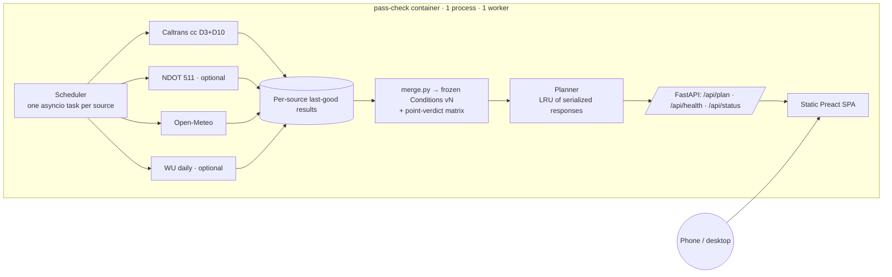

# ✨ feat: Pass Check app, public Docker image, and example compose

## Enhancement Summary

**Deepened on:** 2026-11-15
**Reviewers used:** architecture-strategist, security-sentinel, performance-oracle, code-simplicity-reviewer, kieran-python-reviewer, kieran-typescript-reviewer, frontend-design skill. Earlier research: data-source APIs (live-tested), Docker/GHCR publishing, SpecFlow analysis.

### Key Improvements
1. **Verdict engine split:**
   - Forecast-only `point_verdict`.
   - `segment_verdict` combines the endpoint verdicts with live chain/closure status.
   - Uses `Level` (StrEnum with a severity order), a frozen `Verdict` dataclass, and a `ChainLevel` IntEnum.
   - "Escalate-only" holds by construction via `worst()`.
2. **Clean module boundaries:**
   - A pure `merge.py` builds an immutable, versioned `Conditions` snapshot.
   - The `Source` protocol has a pure `parse()`.
   - The clock and the sources are injected (`create_app(settings, sources, clock)`). Fixture sources replace any test-only branches.
3. **v1 scope cut for safety and size:**
   - No disk persistence and no offline service worker, so an old plan can never be served as current.
   - NWS cross-check and Caltrans RWIS deferred to v1.1.
   - Route geometry is folded into `/api/plan`.
   - Only two env vars.
4. **Performance:**
   - The point-verdict matrix is precomputed once per snapshot.
   - Plan responses are cached by `(version, direction, date, current hour, staleness)`.
   - Days and next-GO are computed once.
   - Pre-serialized bytes with ETag/304 and gzip.
5. **Security:**
   - API keys as `SecretStr`; httpx URL logging silenced; a redaction filter; a sentinel-key test.
   - Strict CSP and security headers; docs/openapi disabled at runtime.
   - Date and direction validation; an allowlist-based static file server.
   - Digest-pinned base images; a fixed numeric UID.
   - Actions pinned by SHA with least-privilege permissions; provenance + SBOM; Trivy scan; Dependabot.
6. **Frontend hardening:**
   - Types generated from OpenAPI, with a CI drift check.
   - Request state modeled as a discriminated union.
   - Polling via `setTimeout` with AbortController and visibility pause.
   - A pure `detectSwipe`; strict tsconfig; vitest; a 30 KB JS budget.
7. **Color-blind safety and legibility:**
   - Verdict glyphs (✓ ▲ ✕) and per-verdict dash patterns on the profile.
   - Barlow Condensed + Atkinson Hyperlegible Next, self-hosted.
   - `aria-live` hero; reduced-motion support.

### New Considerations Discovered
- **Nevada conflict:** "never GO without fresh live data" would cap Spooner Summit and Minden at CAUTION forever whenever no NDOT key is set. The floor now applies only to stretches that have a *configured* live source. Nevada stretches without one are labeled "forecast only".
- **WU data is daily and must not be spread across hours.** Doing so would turn every hour NO GO. It is now a day-level reason only.
- **Arrival times between hours:** an arrival at 2:25 checks both the 2:00 and 3:00 forecast hours and takes the worse.
- **Snow probability above 40% with no accumulation** fell through the sketched rules. It is now explicitly CAUTION.
- **Single uvicorn worker is required**, because the store and scheduler are in-process.
- **Owner preferences kept over simplicity cuts:** swipe (explicitly requested), arm64, the 10-day view, and optional WU support.

## Overview

Build **Pass Check**, a mobile-first web app that answers "Is it safe to drive over the Sierra between Reno and Sacramento if I leave at *this* hour, and on which route?" for I-80, US-50 and SR-88. Ship it as **one public, multi-arch Docker image on GHCR** (`ghcr.io/treasonx/reno_route_planner`) that anyone can `docker pull`, plus an **example `compose.yaml`**.

The product decisions (verdict model, thresholds, UX) were settled in the brainstorm. This plan covers HOW.

## Problem Statement

Winter storms make Sierra crossings dangerous or impossible, and chain controls and closures change hourly. Existing tools show raw data (Caltrans QuickMap, forecasts) but don't answer the planning question: *which route, which departure hour, go or no-go*. The owner wants a self-hostable answer that's simple on a phone.

## Proposed Solution

A single container running a **Python FastAPI** service that:

1. **Pulls data on a schedule** for about 21 sample points along the three routes:
   - Live road data: Caltrans CWWP2 chain controls and closures, plus optional NDOT/nvroads 511.
   - Forecasts: Open-Meteo hourly, plus an optional Weather Underground daily cross-check with the owner's key.
2. **Merges** them into an immutable, versioned `Conditions` snapshot.
3. **Runs a pure, unit-tested verdict engine** (GO / CAUTION / NO GO) per point per hour, precomputed per snapshot.
4. **Runs a planner** that, for each departure hour, does the following:
   - Finds the arrival time at every segment.
   - Combines the forecast and live verdicts for each segment.
   - Takes the worst segment as the route verdict.
   - Picks the best route and writes the hero message.
5. **Serves** `/api/*` JSON and the built **Vite + Preact** frontend (the C2 mockup design, responsive to desktop) as static files.

## Technical Approach

### Architecture



- **No database, no disk persistence.**
  - Each source keeps its last good result in memory.
  - After any source update, `merge()` builds a new frozen `Conditions` with an incremented `version` and precomputes `verdicts[point_id][utc_hour]`.
  - One reference is swapped atomically, so readers never see a half-merged state and no locks are needed.
  - A restart refetches within seconds. A snapshot left on disk could be served after a long outage, which is a safety risk, so there isn't one.
- **Background refresh, not per-request fetching.** Requests never wait on upstream APIs, and visitors can't trigger upstream calls.
- **Single process, single uvicorn worker.** More workers would duplicate polling and make state diverge. The CMD never sets `--workers`, and the README says why.
- **Time:** all arithmetic is in UTC with aware datetimes, rendered in `America/Los_Angeles` (a constant). The `tzdata` package is a dependency so the zone data doesn't depend on the base image. Domain code never calls `datetime.now()`; `now` is passed in from an injected clock.

**Dependency rule** (imports point one way):
- `sources/*` → `domain`
- `merge` → `domain`
- `verdict` → `domain`
- `planner` → `verdict`, `corridors`, `domain`
- `api` → `store`, `planner`, `schemas`
- `main` wires everything together. Nothing imports `api` or `main`.

### Repository layout

```
.
├── backend/
│   ├── pyproject.toml              # uv; requires-python >=3.13; fastapi, uvicorn, httpx, pydantic-settings, tzdata
│   ├── uv.lock
│   ├── src/passcheck/
│   │   ├── main.py                 # create_app(settings, sources, clock); lifespan; middleware; static
│   │   ├── config.py               # Settings: SecretStr keys, source selection
│   │   ├── corridors.py            # routes/segments/points, both directions precomputed at import
│   │   ├── domain.py               # frozen slotted dataclasses: HourlyPoint, LiveStatus, Level, ChainLevel, Verdict, Thresholds
│   │   ├── schemas.py              # pydantic models for the API boundary only (PlanResponse …)
│   │   ├── merge.py                # pure: per-source results → Conditions (with field provenance)
│   │   ├── verdict.py              # pure: point_verdict, segment_verdict, worst
│   │   ├── planner.py              # pure: (Conditions, corridors, now, direction, date) → Plan
│   │   ├── store.py                # last-good per source, atomic Conditions swap, response LRU
│   │   ├── scheduler.py            # refresh_once() + per-source loops
│   │   ├── security.py             # headers middleware, log redaction filter
│   │   ├── api.py                  # /api/plan, /api/health, /api/status
│   │   └── sources/
│   │       ├── base.py             # Source protocol, SourceResult
│   │       ├── caltrans.py         # parse_cc() pure + fetch
│   │       ├── ndot.py
│   │       ├── openmeteo.py
│   │       ├── wu.py
│   │       └── fixtures.py         # fixture Source implementations (mockup scenario)
│   └── tests/
│       ├── fixtures/               # recorded upstream payloads (scrubbed of keys)
│       ├── golden/plan_reno_sac.json
│       ├── conftest.py             # make_hour(**overrides), fixed clock, app factory
│       ├── test_verdict.py         # parametrize(ids=…) threshold tables + hypothesis monotonicity
│       ├── test_planner.py         # arrival math, DST, midnight, ties, next-GO, Nevada floor
│       ├── test_merge.py
│       ├── test_sources_*.py       # parse_x(load_fixture(...)) – no network
│       ├── test_scheduler.py       # refresh_once, failure isolation, key redaction (respx)
│       ├── test_api.py             # golden JSON, validation, headers, ETag, traversal
│       └── test_bench.py           # cold full plan < 20 ms on fixture
├── frontend/
│   ├── package.json, vite.config.ts, tsconfig.json, eslint.config.js
│   ├── index.html
│   ├── public/                     # manifest.webmanifest, icons, apple-touch-icon
│   └── src/
│       ├── main.tsx, App.tsx, theme.css
│       ├── api.gen.ts              # generated by openapi-typescript (CI drift check)
│       ├── api.ts                  # fetchPlan(direction, date, signal)
│       ├── hooks/usePlan.ts, usePolling.ts, useSwipe.ts
│       ├── lib/swipe.ts, storage.ts, verdict.ts
│       ├── __fixtures__/plan.json  # from backend golden file
│       └── components/
│           ├── Header.tsx           # title + direction swap
│           ├── LeaveAtPager.tsx     # 3-hour pages (6 on desktop), chunk bar
│           ├── Hero.tsx             # aria-live; renders server text verbatim
│           ├── RoutesCard.tsx       # tabs + swipe on phone, stacked on desktop
│           ├── RouteProfile.tsx     # SVG profile; color + dash + glyph per verdict
│           ├── TenDay.tsx           # tap a day → load its hours
│           ├── StaleBanner.tsx, DataUnavailable.tsx, Skeleton.tsx, Footer.tsx
├── scripts/export_openapi.py       # dumps app.openapi() for type generation (docs stay off at runtime)
├── Dockerfile
├── .dockerignore
├── compose.yaml                    # example compose (pull public image)
├── .env.example
├── .github/
│   ├── dependabot.yml              # actions, docker, uv, npm
│   └── workflows/
│       ├── ci.yml                  # ruff, pyright, pytest, tsc, eslint, vitest, build, budget, openapi drift
│       └── docker-publish.yml      # multi-arch build, scan, push to GHCR
└── README.md
```

### Configuration (env vars)

| Var | Default | Purpose |
|---|---|---|
| `WU_API_KEY` | *(unset)* | Optional Weather Underground / weather.com PWS key, used for a daily 5-day cross-check. `SecretStr`. |
| `NDOT_API_KEY` | *(unset)* | Optional nvroads 511 developer key (free account at nvroads.com/developers/doc; 10 calls/min). `SecretStr`. Without it, Nevada stretches are forecast-only, and the UI says so. |
| `PASSCHECK_SOURCES` | `live` | `live` uses real upstreams. `fixtures` uses fixture `Source` implementations: the mockup scenario, for UI work, screenshots and browser tests. It goes through the same seam as tests; there are no special code paths. |
| `LOG_LEVEL` | `INFO` | |

Everything else is a constant in code:
- Refresh intervals: live every 300 s, forecast every 3600 s.
- `LIVE_OVERRIDE_HOURS = 3`.
- Timezone, port 8000.
- Thresholds, passed as a frozen `Thresholds` dataclass with defaults so tests can vary them.

**Rule:** never put secrets in `VITE_*` variables, because Vite builds those into the public bundle.

### Domain model

**Corridors** (`corridors.py`) are defined once for Reno → Sacramento. At import, both directions are precomputed: Sacramento → Reno reverses the point order and uses `total − offset` for travel times. The planner never branches on direction.

| Route | Sample points in order (coordinates in "Sample points" below) | Typical minutes from Reno |
|---|---|---|
| I-80 | Reno, Truckee, **Donner Summit**, Kingvale, Yuba Gap, Colfax, Sacramento | 0, 35, **50**, 57, 68, 92, 135 |
| US-50 | Reno, Carson City, **Spooner Summit (NV)**, South Lake Tahoe, Meyers, **Echo Summit**, Twin Bridges, Kyburz, Placerville, Sacramento | 0, 35, 50, 68, 78, **85**, 92, 105, 130, 165 |
| SR-88 | Reno, Minden (NV), Woodfords, **Carson Pass**, Kirkwood, **Carson Spur**, Jackson, Sacramento | 0, 50, 70, **95**, 102, 106, 150, 195 |

- **Segments** are consecutive point pairs: I-80 has 6, US-50 has 9, SR-88 has 7. The SVG profile draws one path per segment.
- **Each point** carries `id, name, lat, lon, elevation_ft, state (CA|NV), live_source (caltrans | ndot | none)` and its profile x/y for the SVG, taken from the mockup.
- **Travel minutes** are fixed typical values, documented as approximate.

**Domain types** (`domain.py`):

```python
class Level(StrEnum):
    GO = "GO"; CAUTION = "CAUTION"; NO_GO = "NO GO"
    @property
    def severity(self) -> int: return _SEVERITY[self]          # GO 0, CAUTION 1, NO_GO 2

class ChainLevel(IntEnum):
    R0 = 0; R1 = 1; R2 = 2; R3 = 3

@dataclass(frozen=True, slots=True)
class LiveStatus:
    chain: ChainLevel; closed: bool; description: str; place: str; observed_at: datetime

@dataclass(frozen=True, slots=True)
class Verdict:
    level: Level
    reasons: tuple[str, ...] = ()

def worst(vs: Iterable[Verdict]) -> Verdict:
    vs = list(vs)
    top = max(v.level.severity for v in vs)
    return Verdict(next(v.level for v in vs if v.level.severity == top),
                   tuple(r for v in vs if v.level.severity == top for r in v.reasons))
```

**Verdict engine** (`verdict.py`): pure functions.

```python
def point_verdict(h: HourlyPoint | None, t: Thresholds = DEFAULT) -> Verdict:
    if h is None:
        return Verdict(Level.CAUTION, (f"No forecast data",))
    if h.snow_in >= t.nogo_snow_in and h.temp_f <= t.freezing_f:           # ≥ 0.5 in at ≤ 34°F
        return Verdict(Level.NO_GO, (f"{h.snow_in:.1f} in of snow",))
    reasons: list[str] = []
    if h.freezing_rain: reasons.append("Freezing rain")
    if 0 < h.snow_in < t.nogo_snow_in and h.temp_f <= t.freezing_f:
        reasons.append("Light snow")
    elif h.snow_prob_pct >= t.caution_snow_prob_pct:                          # ≥ 20 %, incl. > 40 % w/o accumulation
        reasons.append(f"{h.snow_prob_pct}% chance of snow")
    if black_ice_risk(h, t): reasons.append("Black ice risk")
    return Verdict(Level.CAUTION, tuple(reasons)) if reasons else Verdict(Level.GO)

def segment_verdict(a: Verdict, b: Verdict, live: LiveStatus | None,
                    live_floor: bool, arrival: datetime, now: datetime) -> Verdict:
    """Escalate-only: worst(forecast endpoints, live, floor)."""
    parts = [a, b]
    near_term = arrival - now <= timedelta(hours=LIVE_OVERRIDE_HOURS)
    if near_term and live is not None:
        if live.closed:              parts.append(Verdict(Level.NO_GO, (f"Closed at {live.place}",)))
        elif live.chain >= ChainLevel.R1:
            parts.append(Verdict(Level.NO_GO, (f"Chains required ({live.chain.name[0]}-{live.chain.value}) at {live.place}",)))
    if near_term and live_floor:     # configured live source is stale/down
        parts.append(Verdict(Level.CAUTION, ("Live road data unavailable",)))
    return worst(parts)
```

Notes:
- **Snow probability** comes from Open-Meteo `precipitation_probability`. It counts as snow when `temp_f <= 36` or the freezing level is within 1,000 ft of the point's elevation; otherwise it is 0.
- **`black_ice_risk(h)`** is true when `temp_f <= 34` AND any of these holds: `precip_prev_12h_in > 0`, `dewpoint_spread_f <= 3`, or snowmelt (`temp_max_prev_12h > 34`). It applies only from 6 PM to 10 AM local time; `HourlyPoint` carries the local hour.
- **A live R-0 never lowers anything,** because live data only adds parts to `worst()`.
- **Live floor** (`live_floor`) is true only for segments whose points have a configured live source (Caltrans always; NDOT only when the key is set) and whose data is older than 30 min or down. Nevada stretches with no NDOT key are never floored; their caption says "Nevada: forecast only".
- **Every verdict carries human-readable reasons with place names,** which become the caption ("Black ice risk at Truckee, Donner Summit").

**Planner** (`planner.py`): pure, taking `(conditions, corridors[direction], now, date)`. Point verdicts are precomputed lookups.

- For departure `t0` and each segment, arrival `ta = t0 + offset`. When `ta` falls between hours, the segment checks both the **floor and ceiling hours** and takes the worse, which is conservative.
- **Route verdict:** the worst segment. **Caption:** the worst segments' reasons, deduplicated, with place names.
- **Best route:** lowest severity. Tie → the longest consecutive run of that level from `t0`. Final tie → I-80, US-50, SR-88 order.
- **`go_until`:** the last departure hour of the best route's GO run.
- **Hero:**
  - GO → "Take {route}", "GO for departures until {time}".
  - CAUTION → "Careful on {route}".
  - NO GO → "Don't cross", plus the next GO departure within 10 days, or "No clear window in the next 10 days".
- **Day verdict (10-day strip):** the best verdict achievable for any departure between 6 AM and 8 PM that day. *(This refines the brainstorm's "worst"; see Open Questions.)* Days 8–10 are marked `low_confidence`.
- **DST:** departure hours are generated by stepping in UTC. On spring-forward days 2 AM is skipped; on fall-back days two "1 AM" entries appear, labeled "1 AM PDT" and "1 AM PST".
- **Midnight:** arrivals after midnight look up the next day's hours.

### API

`GET /api/plan?direction=reno-sac|sac-reno&date=YYYY-MM-DD`

- **`direction`** is an Enum. **`date`** must be between today and today+10 (Pacific time); anything else returns 422.
- **No `date`:** 24 departure hours starting at the current hour, labeled "Now". **With `date`:** 24 hours from 00:00 that day; the UI opens the pager at 6 AM.
- **`routes`** is a fixed-key model (`i80`, `us50`, `sr88`), not `dict[str, …]`. Its `segments` array length matches the corridor.
- **Static `corridors` geometry** (points, profile coordinates, towns, elevations) is included in the same response, so there's no extra round trip and no separate `/api/meta`.

```jsonc
{
  "generated_at": "2026-11-15T07:02:11-08:00",
  "snapshot_version": 42,
  "direction": "reno-sac",
  "corridors": { "us50": { "name": "US-50", "summit": "Echo Summit",
                 "points": [{ "id": "reno", "name": "Reno", "x": 10, "y": 76, "elevation_ft": 4505 }, "…"] }, "…": {} },
  "hours": [
    {
      "depart": "2026-11-15T07:00:00-08:00", "label": "Now",
      "best": { "route": "us50", "verdict": "GO" },
      "hero": { "title": "Take US-50", "sub": "GO for departures until 12 PM", "body": "Dry the whole way." },
      "routes": {
        "i80":  { "verdict": "CAUTION", "caption": "Black ice risk at Truckee, Kingvale", "summit_eta": "2026-11-15T07:50:00-08:00", "segments": ["GO","CAUTION","CAUTION","CAUTION","CAUTION","GO"] },
        "us50": { "verdict": "GO", "caption": "Dry the whole way.", "summit_eta": "2026-11-15T08:25:00-08:00", "segments": ["GO","GO","GO","GO","GO","GO","GO","GO","GO"] },
        "sr88": { "verdict": "NO GO", "caption": "Chains required (R-2) at Carson Spur", "summit_eta": "2026-11-15T08:35:00-08:00", "segments": ["GO","GO","NO GO","NO GO","NO GO","CAUTION","GO"] }
      }
    }
  ],
  "days": [ { "date": "2026-11-15", "verdict": "GO", "best_route": "us50", "low_confidence": false } ],
  "sources": { "caltrans": { "ok": true, "age_s": 140 }, "openmeteo": { "ok": true, "age_s": 900 },
               "ndot": { "ok": false, "configured": false }, "wu": { "ok": true, "configured": true } },
  "stale": false
}
```

- **`GET /api/health`:** liveness only. Returns `200 {"ok": true}` whenever the process is serving. Docker's `HEALTHCHECK` uses it; a dead upstream must not restart-loop the container.
- **`GET /api/status`:** readiness and freshness. For each source: `configured`, `ok`, `last_success`, `age_s`, `consecutive_failures`, and a redacted `last_error` (exception type and status code only). The `sources` block in `/api/plan` is built from the same object, so the two can never disagree.
- **Unknown `/api/*` paths** return a JSON 404.
- **FastAPI `docs_url`, `redoc_url` and `openapi_url` are disabled at runtime.** `scripts/export_openapi.py` dumps the schema for type generation.

**Caching and transport:**
- **Cache key:** `(snapshot_version, direction, date|"now", current_hour_utc, live_floor_flags)`. It includes time, because the live-override window and the staleness floor move as the clock advances even when the data doesn't.
- **Cached value:** serialized bytes plus an ETag, in an LRU of about 24 entries that is cleared on each version swap.
- **Computed per request, outside the cached body:** `generated_at`, `sources.age_s` and `stale`. They are sent as a tiny overlay; or keep it simple and include them in the cache key's hour bucket.
- **Days and next-GO** are computed once per `(version, direction, hour)` and shared across `date` requests.
- **`GZipMiddleware(minimum_size=1000)`.** The payload is about 20 KB raw and about 3 KB gzipped. `If-None-Match` returns 304.

**SPA serving:**
- The API router is registered first.
- `/assets/*` is served with `Cache-Control: public, max-age=31536000, immutable`.
- Any other path is served only if it **exactly matches an allowlist** of top-level files built from `dist` at startup (manifest, icons, favicon). Everything else gets `index.html` with `Cache-Control: no-cache`.
- There is no filesystem path joining from user input, so traversal is impossible.

**Security headers middleware** (`security.py`):
- `Content-Security-Policy: default-src 'self'; script-src 'self'; style-src 'self'; img-src 'self' data:; font-src 'self'; connect-src 'self'; manifest-src 'self'; object-src 'none'; base-uri 'none'; form-action 'none'; frame-ancestors 'none'`
- `X-Content-Type-Options: nosniff`
- `Referrer-Policy: no-referrer`
- `Cross-Origin-Opener-Policy: same-origin`
- A minimal `Permissions-Policy`
- No CORS middleware. HSTS is left to the reverse proxy (documented in the README).

**Logging:**
- One stdout line per fetch: source, status, latency and item count.
- The `httpx` and `httpcore` loggers are set to WARNING, because httpx logs full URLs, including `?apiKey=`.
- A root logging filter rewrites `(api)?key=[^&\s]+` to `key=REDACTED`.
- Exceptions are logged as `type(e).__name__` plus status code, never `str(e)`.
- Upstream strings are logged via `repr`, with control characters stripped and a 200-character cap.
- On boot, the app logs which optional sources are enabled.

### Data sources

| Need | v1 source | Notes |
|---|---|---|
| CA chain controls / closures | **Caltrans CWWP2 `cc`** (D3: I-80, US-50; D10: SR-88) | always on, no key |
| NV conditions (Spooner, Carson City, Minden) | nvroads 511 `roadconditions` + `event` | optional (`NDOT_API_KEY`) |
| Hourly forecast, days 1–10 | **Open-Meteo** | always on, no key; CC-BY attribution |
| Daily cross-check, days 1–5 | WU/TWC daily 5-day | optional (`WU_API_KEY`); day-level reason only |
| *(v1.1)* NWS gridpoint snowfall cross-check | NWS `/gridpoints` | deferred: 6 h blocks, User-Agent, grid lookups |
| *(v1.1)* Road surface temp | Caltrans RWIS | deferred: D10 returned invalid JSON in testing; air-temp heuristic covers v1 |

**Why Open-Meteo is primary:** research found that a PWS-contributor WU key grants only the **daily 5-day** forecast, with no hourly and no 10-day. WU is kept because the owner wants it, as an optional *day-level* signal. If WU's daily forecast says snow ≥ ½ in at a summit and Open-Meteo shows none that day, the day gets a CAUTION reason "WU expects snow". It is never spread across hourly snowfall, which would turn every hour NO GO.

**Merge (`merge.py`):** pure. Per point per hour, Open-Meteo supplies the temperature, dewpoint, snowfall, precipitation probability, weather code and freezing level. Freezing rain is `weather_code ∈ {56,57,66,67}`. Each field records its provenance.

**Source protocol** (`sources/base.py`):

```python
class Source(Protocol):
    name: str
    kind: Literal["live", "forecast"]
    interval_s: int
    configured: bool
    async def fetch(self, client: httpx.AsyncClient) -> bytes: ...
    def parse(self, raw: bytes, now: datetime) -> SourceResult: ...     # pure, tested on fixture bytes
```

**Scheduler** (`scheduler.py`):
- `refresh_once(source, store, client, clock)` is tested directly.
- Each source has a loop that sleeps for its interval, staggering the first run, and wraps `refresh_once` in `try/except Exception` so one failing source never kills its task.
- Retry/backoff is a simple fixed retry delay.
- One shared `httpx.AsyncClient`:
  - Timeouts: connect 5 s, read 15 s.
  - `follow_redirects=False`, TLS verification always on.
  - Responses capped at 5 MB.
- JSON over about 200 KB is parsed with `asyncio.to_thread`.
- Raw payloads are dropped right after parsing.
- Base URLs are constants and cannot be overridden by env.
- The lifespan creates the client and the tasks, then cancels and awaits them on shutdown.

### Live vs forecast precedence

- **Escalate-only,** by construction via `worst()`. A live "no chains" never downgrades a forecast NO GO.
- **Live data applies to arrivals within 3 hours of `now`** (not of the fetch time). Beyond that, the forecast rules alone.
- **Closed vs chains:** both are NO GO, with distinct wording ("Closed at Carson Spur" vs "Chains required (R-2) at Kingvale").

### Stale / failure behavior

- **Configured live source down or older than 30 min:** near-term arrivals on its stretches get a **CAUTION floor**, so the verdict can't read better than CAUTION. A banner says "Caltrans data is delayed. Check QuickMap."
- **Forecast older than 6 h:** banner plus `stale: true`.
- **No `Conditions` yet** (first boot, or every forecast source down): `/api/plan` returns 503 with `{"status":"unavailable"}`. The UI shows "Couldn't reach forecast sources", a Retry button and the QuickMap link. **Never a GO.**
- **Missing data for a point/hour:** CAUTION, "No data for {place}".
- **NO GO for all 10 days:** the hero says "No clear window in the next 10 days".

### Frontend

**Stack and state:**
- Vite + Preact + TypeScript, no UI framework.
- Hooks for state, not signals. `App` owns direction, date, hour index and route tab; the tab resets to `best.route` when the hour changes.
- Components are prop-only and use named exports.

**Types:**
- `openapi-typescript` generates `api.gen.ts` from `scripts/export_openapi.py`. CI regenerates it and runs `git diff --exit-code`.
- The backend uses `Literal`/Enum for verdict, route id and direction, so they generate as unions.

**Request state:**
```ts
type PlanState =
  | { status: "loading" }
  | { status: "ready"; plan: PlanResponse }
  | { status: "error"; error: string; lastPlan?: PlanResponse };
```
- When a poll fails, the last good plan stays visible with a stale banner.
- Staleness is also checked on the client from `generated_at` (over 15 min means stale).
- The `error` state with no plan renders `DataUnavailable`, never a verdict.

**Polling:**
- Chained `setTimeout` calls every 5 minutes.
- Pauses on `visibilitychange`, and refetches right away when the page becomes visible if the data is older than 5 minutes.
- Each request gets its own `AbortController`, aborted when direction or date changes, so a late response can't overwrite a newer view.

**Swipe:**
- `lib/swipe.ts` holds a pure, unit-tested `detectSwipe(dx, dy, min = 40): "prev" | "next" | null`.
- `useSwipe` uses `setPointerCapture`, handles `pointercancel`, and sets `touch-action: pan-y`.
- Tabs follow the roving-`tabindex` pattern so ←/→ moves between them, and the profile SVG accepts ←/→ too.

**Storage:** direction lives in `localStorage` (inside try/catch) and is validated with the `isDirection` type guard.

**Layout:** one responsive layout.
- Under 900px: stacked, with the pager showing 3 hours.
- At 900px and up: two columns, the pager showing 6 hours, and all three profiles stacked with the best route highlighted.
- No horizontal scrolling anywhere.

**Design tokens** (from the mockup and the frontend-design review):
```css
:root{
  --bg:#0B0F14; --card:#151B23; --card-2:#1C2430; --line:#263040;
  --text:#E8EDF3; --muted:#8A97A8;
  --go:#34C27A; --caution:#F5C84B; --nogo:#F0524A;
  --go-tint:color-mix(in oklab,var(--go) 14%,var(--card));
  --caution-tint:color-mix(in oklab,var(--caution) 14%,var(--card));
  --nogo-tint:color-mix(in oklab,var(--nogo) 14%,var(--card));
  --radius:16px; --radius-sm:10px;
  --s1:4px; --s2:8px; --s3:12px; --s4:16px; --s6:24px; --s8:32px;
  --font-display:"Barlow Condensed",sans-serif;
  --font-body:"Atkinson Hyperlegible Next",system-ui,sans-serif;
}
.num,.pager-hour{font-variant-numeric:tabular-nums}
:focus-visible{outline:2px solid var(--text);outline-offset:3px}
@media (prefers-reduced-motion:reduce){*{transition-duration:.01ms!important;animation:none!important}}
```

**Fonts:**
- Barlow Condensed 600/700 for the verdict word, pager hours and big numbers.
- Atkinson Hyperlegible Next, variable, for body text.
- Self-hosted via Fontsource, Latin subset only, `font-display: swap`, with the display font preloaded. No Google Fonts call, so the CSP stays strict.

**Color-blind safety:** green and red have similar lightness, so every verdict has a second cue besides color.
- The verdict word always appears with a glyph: ✓ GO, ▲ CAUTION, ✕ NO GO.
- Profile segments use per-verdict dash patterns: GO solid, CAUTION `stroke-dasharray:10 4`, NO GO `3 3`.
- The 10-day cells show the same glyphs.

**Motion:**
- When the hour changes, the verdict word cross-fades with a 4px slide.
- Segment strokes transition color.
- The chunk-bar indicator moves with `transform` only.
- All of it is disabled when reduced motion is on.

**Accessibility:**
- The hero has `aria-live="polite"`.
- Touch targets are 44px or more.
- WCAG AA contrast.
- The profile SVG has `role="img"` and a descriptive `aria-label`.

**Loading and empty states:**
- Skeletons match the shapes of the real cards, so the layout doesn't jump.
- A stale pill reads "As of 6:42 AM PT"; the hero drops to opacity 0.85.
- Pager hours without data are hatched and read "No forecast yet".

**Text:** the hero and captions render the server's text verbatim, so PT and DST labels come only from the server. Preact escapes text by default, and ESLint bans `dangerouslySetInnerHTML`.

**Install:**
- `manifest.webmanifest`, icons and `apple-touch-icon` for "Add to Home Screen".
- **No service worker in v1,** because offline cached verdicts are unsafe for a go/no-go app.
- The README notes that installing as an app needs HTTPS: Caddy, `tailscale serve`, or a Cloudflare Tunnel.

**Budget:** CI fails if the gzipped JS exceeds 30 KB (fonts excluded). No date library; use `Intl` and the server labels. Source maps are off in production builds.

**Dev:** the Vite proxy sends `/api` to `http://localhost:8000`, and the backend runs with `PASSCHECK_SOURCES=fixtures`.

**Strict `tsconfig.json`:**
```jsonc
{ "compilerOptions": {
  "strict": true, "noUncheckedIndexedAccess": true, "exactOptionalPropertyTypes": true,
  "verbatimModuleSyntax": true, "moduleResolution": "bundler", "noEmit": true,
  "jsx": "react-jsx", "jsxImportSource": "preact", "types": ["vite/client"] } }
```

### Docker image

Multi-stage `Dockerfile`. Versions were verified in November 2026. **Base images are pinned by `@sha256` digest**; the digests are resolved during implementation and kept fresh by Dependabot.

1. **`FROM --platform=$BUILDPLATFORM node:26-slim@sha256:… AS web`:**
   - `npm ci --ignore-scripts` with a cache mount, then `npm run build` → `/web/dist`.
   - The assets are built once, natively, because they don't depend on CPU architecture.
2. **`FROM python:3.13-slim@sha256:… AS builder`:**
   - `COPY --from=ghcr.io/astral-sh/uv:0.13.8@sha256:… /uv /uvx /bin/`
   - `UV_COMPILE_BYTECODE=1 UV_LINK_MODE=copy UV_NO_DEV=1 UV_PYTHON_DOWNLOADS=0`
   - `uv sync --frozen --no-install-project --no-editable` with the lockfile bind-mounted, then a full `uv sync --frozen --no-editable`.
3. **Final `FROM python:3.13-slim@sha256:…`:** the same base and `/app` path as the builder, so the venv symlinks hold.
   - A fixed numeric user: `groupadd -g 10001 app && useradd -u 10001 -g 10001 --no-create-home app`.
   - Copy the venv, and copy `dist` to `/app/static`.
   - `ENV PATH=/app/.venv/bin:$PATH PYTHONUNBUFFERED=1 STATIC_DIR=/app/static`
   - `USER 10001:10001`; `EXPOSE 8000`.
   - `HEALTHCHECK` uses Python `urllib` against `/api/health`, since the slim image has no curl.
   - `CMD ["uvicorn","passcheck.main:app","--host","0.0.0.0","--port","8000","--no-server-header","--limit-concurrency","100","--timeout-keep-alive","5"]`. A single worker, with no `--proxy-headers '*'`.
4. **`LABEL org.opencontainers.image.source=https://github.com/treasonx/reno_route_planner`.**
5. **`.dockerignore`:** `.git`, `**/.venv`, `**/node_modules`, `frontend/dist`, `docs`, `**/.env*`, `!.env.example`, `*.pem`.

### Publishing (GitHub Actions → GHCR)

**`.github/workflows/docker-publish.yml`:**
- **Triggers:** push to `main`, tags `v*`, and `workflow_dispatch`. `pull_request` builds without pushing. Never `pull_request_target`.
- **Permissions:** top-level `permissions: {}`. The job gets `contents: read`, `packages: write`, `id-token: write` and `attestations: write`.
- **Pinning:** every action is pinned to a **full commit SHA**, with the tag in a comment; the SHAs are resolved via `gh api` during implementation.
  - `actions/checkout@v7` (`persist-credentials: false`)
  - `docker/setup-qemu-action@v4`, `docker/setup-buildx-action@v4`
  - `docker/login-action@v4` (ghcr.io, `github.actor`, `GITHUB_TOKEN`)
  - `docker/metadata-action@v6`, with env `DOCKER_METADATA_ANNOTATIONS_LEVELS: manifest,index`
  - `docker/build-push-action@v7`
- **Build:**
  - `platforms: linux/amd64,linux/arm64`; labels and annotations.
  - `cache-from: type=gha`. `cache-to: type=gha,mode=max` only on non-PR events, so PR builds can't poison the cache.
  - `provenance: mode=max`, `sbom: true`.
- **Scan:** Trivy scans the image and fails on fixable CRITICAL vulnerabilities before push.
- **Tags:** `type=raw,value=latest,enable={{is_default_branch}}`, `type=semver,pattern={{version}}`, `type=semver,pattern={{major}}.{{minor}}`, `type=sha`. The image name must be lowercase.
- **Public pull:** GHCR packages are **private by default**, even in a public repo; they inherit access permissions, not visibility. This repo is private too, and that's fine, because package visibility is set separately. After the first push: package page → Package settings → Change visibility → Public. This is **irreversible and outward-facing, so the owner does it manually.** The README documents it. Verify with `docker logout ghcr.io && docker pull ghcr.io/treasonx/reno_route_planner:latest`.

**`.github/workflows/ci.yml`:** top-level `permissions: contents: read`.
- **Backend:** `uv sync --locked`, `ruff check`, `ruff format --check`, `pyright`, `pytest`.
- **Frontend:** `npm ci`, `tsc --noEmit`, `eslint`, `vitest run`, `vite build`, the bundle budget check, and the OpenAPI type drift check.
- **Secrets:** a grep that fails if fixtures contain `apiKey=` or `key=` values.

**`.github/dependabot.yml`:** weekly updates for github-actions, docker, uv and npm.

### Example compose

```yaml
# compose.yaml
services:
  pass-check:
    image: ghcr.io/treasonx/reno_route_planner:latest
    container_name: pass-check
    ports:
      - "8000:8000"            # use "127.0.0.1:8000:8000" behind a reverse proxy
    env_file:
      - path: .env             # optional: WU_API_KEY, NDOT_API_KEY (see .env.example)
        required: false        # runs on Caltrans + Open-Meteo with no keys
    read_only: true
    tmpfs:
      - /tmp
    cap_drop: [ALL]
    security_opt:
      - no-new-privileges:true
    restart: unless-stopped
```

No top-level `version:`, which is obsolete in Compose v2, and no volume, since the app keeps nothing on disk. The image defines the healthcheck. `.env.example` lists `WU_API_KEY=` and `NDOT_API_KEY=`. The README says the app has **no authentication**. For a public deployment, it recommends a reverse proxy providing TLS, HSTS and per-IP rate limiting.

### Implementation Phases

#### Phase 1: Skeleton that ships (foundation)
- `.gitignore`, README stub, `uv` project, Vite + Preact scaffold.
- `create_app` with `/api/health`, security headers, the allowlist static server and log redaction.
- `Dockerfile`, `.dockerignore`, `compose.yaml`, `.env.example`, `ci.yml`, `docker-publish.yml`, `dependabot.yml`.
- **Success:** `docker build` works locally, and `docker compose up` serves the placeholder with a healthy healthcheck. The container runs as uid 10001.

#### Phase 2: Domain core (no network)
- `corridors.py`, `domain.py`, `verdict.py`, `merge.py`, `planner.py`, `store.py`, `schemas.py`, `sources/fixtures.py`, and `/api/plan` + `/api/status`.
- **Tests:**
  - Table-driven tests for every threshold boundary: 34°F, ½ in, 20%, over 40% with no accumulation.
  - Black ice; escalate-only live data; the Nevada floor rule; arrivals between hours.
  - Best-route tie-breaks; `go_until`; reverse-direction offsets; midnight crossing; both DST days; no clear window in 10 days.
  - Hypothesis monotonicity: more snow, a colder temperature or worse live status never improves the verdict.
  - A golden JSON test of the mockup scenario.
  - Date/direction validation; ETag/304; the traversal probes `/..%2f`, `/%2e%2e/` and a symlink; headers present.
  - A benchmark: a cold full plan in under 20 ms.
- **Success:** `pytest` passes, and `/api/plan` reproduces the mockup scenario under `PASSCHECK_SOURCES=fixtures`.

#### Phase 3: Data sources
- Caltrans `cc` for D3 and D10, Open-Meteo (multi-location request), and optional NDOT and WU.
- Pure `parse_*` functions tested against scrubbed recorded fixtures; `refresh_once` and the scheduler.
- A sentinel-key test proves the keys never appear in logs.
- **Success:**
  - A local run with real network gives plausible verdicts for today.
  - Killing a source degrades gracefully, with the floor and banner showing.
  - The upstream call budget stays as documented.

#### Phase 4: Frontend (C2 + desktop)
- Generated types; Header, LeaveAtPager, Hero, RoutesCard (tabs, swipe, keyboard, stacked on desktop), RouteProfile, TenDay (tap → `?date=`), StaleBanner, DataUnavailable, Skeleton, Footer (data credits + QuickMap link).
- The manifest and icons.
- vitest coverage: `detectSwipe`, `isDirection`, `usePolling` with fake timers, and an App test where the error state never shows GO.
- **Success:** it matches the mockups at 390px and 1280px, works by keyboard and screen reader, and stays within the bundle budget.

#### Phase 5: Release
- README covering:
  - What the app is, with the safety disclaimer.
  - Running it with compose, and the env vars.
  - The single-worker note, and HTTPS for installing as an app.
  - Making the GHCR package public.
  - Data sources and attribution: Open-Meteo CC-BY, Caltrans, NDOT, WU.
- Tag `v0.1.0`, which publishes the image. Verify anonymous `docker pull` on amd64 and arm64. The owner flips the package visibility to public.

## Alternative Approaches Considered

- **All-TypeScript (Node/Hono or SvelteKit):** one toolchain, but the owner's tooling is Python, and the verdict engine benefits from pytest table tests plus hypothesis. Rejected; the multi-stage build hides the cost of two languages.
- **Client-side only (a static site calling the APIs from the browser):** it would leak the API keys and run into CORS on Caltrans and NDOT. Rejected.
- **Per-request upstream fetching:** slow, risky against rate limits, and lets visitors amplify upstream calls. Rejected in favor of background refresh.
- **Disk persistence or an offline service worker:** faster cold start and offline use, but it risks showing an old "GO" as current. Rejected for v1.
- **Five data sources in v1:** NWS and RWIS add moderate safety value at a large code cost. Deferred to v1.1.
- **Docker Hub instead of GHCR:** GHCR works with `GITHUB_TOKEN` and repo permissions, with no extra account or secret. GHCR chosen.

## Acceptance Criteria

### Functional
- [ ] `/api/plan` returns 24 departure hours with the best route, hero text, per-route verdict, caption, summit ETA and segment verdicts, plus 10 day verdicts and the corridor geometry.
- [ ] Verdict rules match the brainstorm table, including the clarified "over 40% with no accumulation → CAUTION".
- [ ] Live Caltrans/NDOT chains or closures force NO GO for arrivals within 3 h of now, escalate-only.
- [ ] Segment verdicts use arrival time, and an arrival between hours checks both surrounding hours.
- [ ] Direction swap (Reno ⇄ Sacramento) works and persists.
- [ ] Tapping a day loads that day's hours, with the pager opening at 6 AM.
- [ ] Missing or stale data never produces GO. A stale configured live source floors its stretches at CAUTION, and banners are shown.
- [ ] Works with no keys at all (Caltrans + Open-Meteo). `WU_API_KEY` and `NDOT_API_KEY` are optional; Nevada stretches without NDOT are labeled forecast-only.
- [ ] The footer credits the data sources (Open-Meteo CC-BY, Caltrans, NDOT, WU) and links to QuickMap.

### Non-functional
- [ ] The UI matches the C2 mockup on phone (390px) and desktop (1280px and up), with no horizontal scrolling anywhere.
- [ ] WCAG AA contrast. The verdict word and glyph always appear, profile segments have dash patterns, and touch targets are 44px or more.
- [ ] A cold full-plan benchmark runs in under 20 ms; a cached `/api/plan` p95 is under 100 ms.
- [ ] JS is 30 KB gzipped or less.
- [ ] Upstream calls per day stay within the documented budget.
- [ ] The image is under 200 MB, runs as uid 10001, passes the healthcheck within 30 s, and has no fixable CRITICAL vulnerabilities per Trivy.

### Security
- [ ] A sentinel API key never appears in logs, `/api/status`, the image layers or the frontend bundle.
- [ ] The CSP and other security headers are present. `/docs` and `/openapi.json` return 404 at runtime.
- [ ] Traversal probes return `index.html` or a 404, never file contents. An out-of-range `?date=` returns 422.
- [ ] Actions are SHA-pinned with least-privilege permissions, and images carry provenance and an SBOM.

### Delivery
- [ ] `docker pull ghcr.io/treasonx/reno_route_planner:latest` works **without login** on amd64 and arm64.
- [ ] `docker compose up -d` with the example `compose.yaml` serves the app on `:8000`.
- [ ] CI runs ruff, pyright, pytest, tsc, eslint, vitest, the vite build, the bundle budget, the OpenAPI drift check and the fixture secret grep on every PR.

## Dependencies & Risks

| Risk | Mitigation |
|---|---|
| WU PWS key only grants daily 5-day (confirmed by docs) | Open-Meteo hourly is primary; WU optional, day-level only |
| Open-Meteo free tier is non-commercial, CC-BY | Personal use fits; attribution in the footer and README; the README warns users of the public image |
| NV 511 needs a key and was unverified | Optional; Nevada stretches are forecast-only without it, clearly labeled, and never floored |
| Caltrans feed formats change or go down | Parser tests on fixtures; per-source isolation; staleness floor; never GO on unknown |
| Caltrans R-1/R-2/R-3 strings not observed live | Regex `^R-?([0-3])$`; unknown statuses → CAUTION with the raw text |
| Forecast ≠ reality (false GO) | Conservative rules, both-hours arrival check, CAUTION on missing data, disclaimer and QuickMap link everywhere |
| Fixed travel times are wrong in storms | Documented as approximate; both-hours check |
| GHCR package defaults to private; repo `treasonx/reno_route_planner` is private | Package visibility is set separately; a one-time manual owner step (irreversible); verified with an anonymous pull |
| Actions minutes on a private repo; slow arm64 under QEMU | The frontend is built once on `$BUILDPLATFORM`; only `uv sync` runs under emulation; the GHA cache |
| Upstream strings are untrusted | Text-only rendering, length caps, control-character stripping, no upstream URLs rendered or followed |

## Open Questions (defaults chosen)

1. **Day verdict semantics** → default: the best achievable verdict over 6 AM–8 PM departures. The brainstorm said "worst", but "worst" would make nearly every winter day red.
2. **US-50 path from Reno** → default via Carson City and Spooner Summit, not Mt Rose Hwy.
3. **SR-88 to Sacramento** → default Jackson → SR-16.
4. **Image/repo name** → `ghcr.io/treasonx/reno_route_planner`, derived from the existing remote `treasonx/reno_route_planner`.
5. **Live override window** → 3 hours from now, escalate-only.
6. **Python version** → 3.13, since 3.12 gets security fixes only.

## Data source details

Verified live on 2026-11-15 unless marked.

**Caltrans CWWP2** (no key; JSON/XML/CSV; no published rate limit; records are a few minutes old, so poll every 5 min):
- Chain controls: `https://cwwp2.dot.ca.gov/data/d3/cc/ccStatusD03.json`, `https://cwwp2.dot.ca.gov/data/d10/cc/ccStatusD10.json`
- RWIS (v1.1): `https://cwwp2.dot.ca.gov/data/d3/rwis/rwisStatusD03.json`, `.../d10/rwis/rwisStatusD10.json`. D10 returned **invalid JSON** at test time.
- Lane closures (`lcs`, D3 about 1.75 MB) are **out of scope**. Full closures appear as `ROAD CLOSED` in `cc`.
- **`cc` record:** `data[].cc.location{route:"I-80", locationName, nearbyPlace, latitude, longitude, elevation, direction, postmile}`, `inService`, `statusData{statusTimestamp{statusDate,statusTime}, status, statusDescription}`.
  - `status` values: `R-0` (none), `R-1`/`R-2`/`R-3` (parse with the regex `^R-?([0-3])$` into `ChainLevel`), and `ROAD CLOSED` (`closed=True`).
  - Unknown status strings → CAUTION with the sanitized raw description.
- **Mapping chain points to segments:**
  - Filter by `route` ∈ {I-80, US-50, SR-88} and skip `inService == false`.
  - Assign each point to the nearest segment of that route by haversine distance to the segment's endpoints.
  - Within a segment, the worst status wins.

**nvroads 511** (key required; 10 calls per 60 s; UNVERIFIED without a key):
- `https://www.nvroads.com/api/v3/get/roadconditions?key=…` → `RoadwayName`, `Overall Status` (free text such as "Chains Required…" or "Holding Traffic"), `LastUpdated` (Unix time).
- `https://www.nvroads.com/api/v2/get/event?key=…` → `IsFullClosure`, `EventType`, `Latitude/Longitude`.
- **Mapping the text to levels:**
  - Contains "closed" → closed.
  - "chains required" → R2.
  - "chain" or "traction" → R1.
  - "holding" → a CAUTION reason.

**Open-Meteo** (no key; free for **non-commercial** use, under 10k calls/day; **CC-BY 4.0, attribution required**):
- `https://api.open-meteo.com/v1/forecast?latitude=…&longitude=…&elevation=<m>&hourly=temperature_2m,dew_point_2m,snowfall,precipitation,precipitation_probability,weather_code,freezing_level_height&forecast_days=11&timezone=UTC&temperature_unit=fahrenheit&precipitation_unit=inch`
- Accepts comma-separated multiple locations, so **one call per refresh** covers every point; verify this in Phase 3. Otherwise it's about 21 calls per hour.

**WU/TWC** (PWS key; about 1500 calls/day, UNVERIFIED): `https://api.weather.com/v3/wx/forecast/daily/5day?geocode=LAT,LON&format=json&units=e&language=en-US&apiKey=KEY`. A key without the entitlement returns "Api not allowed for this api key"; then disable WU and log it once.

**NWS** (v1.1): `/points/{lat},{lon}` → grid (Donner → STO 87,94), then `/gridpoints/{wfo}/{x},{y}` → `snowfallAmount` (mm, `PT6H`), `iceAccumulation`, `snowLevel`. Needs a User-Agent with contact details.

**Call budget per day (v1):**
- Caltrans: 2 files × 288 = 576
- NDOT: 2 × 288 = 576 (under 10/min)
- Open-Meteo: 24 to 504
- WU: 3 summits × 24 = 72

All within limits.

### Sample points (from research; CT = Caltrans elevation)

| Route | Point | Lat, Lon | Elev ft |
|---|---|---|---|
| I-80 | Truckee | 39.3280, -120.1833 | 5,820 |
| I-80 | **Donner Summit** | 39.3392, -120.3481 | 7,214 (CT) |
| I-80 | Kingvale | 39.3142, -120.4461 | 6,076 (CT) |
| I-80 | Yuba Gap / Emigrant Gap | 39.3168, -120.6145 | 5,770 (CT) |
| I-80 | Colfax | 39.0967, -120.9494 | 2,421 (CT) |
| US-50 | Carson City (NV) | 39.1638, -119.7674 | 4,688 |
| US-50 | **Spooner Summit** (NV) | 39.1036, -119.8964 | 7,155 |
| US-50 | South Lake Tahoe | 38.9399, -119.9772 | 6,270 |
| US-50 | Meyers | 38.8495, -120.0255 | 6,341 (CT) |
| US-50 | **Echo Summit** | 38.8131, -120.0297 | 7,401 (CT) |
| US-50 | Twin Bridges | 38.8114, -120.1228 | 6,158 (CT) |
| US-50 | Kyburz | 38.7741, -120.2963 | 4,075 |
| US-50 | Placerville | 38.7296, -120.7985 | 1,863 |
| SR-88 | Minden (NV) | 38.9541, -119.7655 | 4,727 |
| SR-88 | Woodfords | 38.7799, -119.8187 | 5,535 |
| SR-88 | **Carson Pass** | 38.6946, -119.9890 | 8,574 |
| SR-88 | Kirkwood | 38.7027, -120.0715 | 7,723 (CT) |
| SR-88 | **Carson Spur** (often first to close) | 38.7056, -120.1090 | 7,972 (CT) |
| SR-88 | Jackson | 38.3488, -120.7741 | 1,223 |

Endpoints Reno (39.5296, -119.8138, 4,505 ft) and Sacramento (38.5816, -121.4944, 30 ft) are shared. The Spooner, Woodfords and Kyburz coordinates are estimates checked against DEM elevations; confirm them in Phase 2.

## References

- Brainstorm: `docs/brainstorms/2026-11-15-pass-check-brainstorm.md`
- Mockups: https://claude.ai/artifact/DttPZoFQ9FFxdJNZ3NwNs8
- Caltrans CWWP2: https://cwwp2.dot.ca.gov/
- nvroads 511 developer docs: https://www.nvroads.com/developers/doc
- Open-Meteo docs/terms: https://open-meteo.com/en/docs, https://open-meteo.com/en/terms
- NWS API: https://www.weather.gov/documentation/services-web-api
- TWC PWS contributor APIs: https://www.wunderground.com/member/api-keys
- uv in Docker: https://docs.astral.sh/uv/guides/integration/docker/
- FastAPI static files: https://fastapi.tiangolo.com/tutorial/static-files/
- Multi-platform builds with GitHub Actions: https://docs.docker.com/build/ci/github-actions/multi-platform/
- docker/metadata-action: https://github.com/docker/metadata-action
- GHCR: https://docs.github.com/en/packages/working-with-a-github-packages-registry/working-with-the-container-registry
- Package visibility: https://docs.github.com/en/packages/learn-github-packages/configuring-a-packages-access-control-and-visibility
- openapi-typescript: https://openapi-ts.dev/
- Fontsource: https://fontsource.org/
